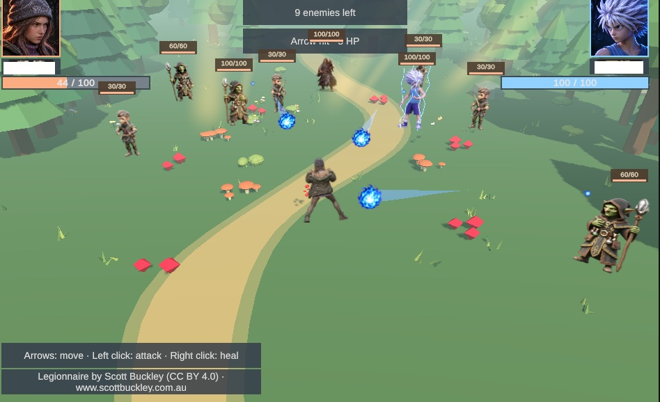

# FightingFireDragon3 · Firelight Forest

[線上遊玩](https://hoho0106tw.github.io/FightingFireDragon3/play-8dcd18b.html)

《Firelight Forest》是一款 Unity 3D 森林戰鬥遊戲。你從林間入口出發，操控主人公發射紅色火球。先打敗只有 10 點血量的低級精靈，再沿小徑進入主戰場，迎戰分布在森林各處的精靈、魔法師和帶著閃電的魔王。

## 操作方式

| 裝置 | 操作 | 效果 |
| --- | --- | --- |
| 電腦 | 方向鍵 ↑ ↓ ← → | 移動主人公 |
| 電腦 | 滑鼠左鍵 | 朝游標方向發射紅色火球 |
| 電腦 | 滑鼠右鍵 | 最多回復 20 HP，冷卻 5 秒 |
| 觸控 | 點地面 | 移動到指定位置 |
| 觸控 | 點敵人 | 鎖定敵人並攻擊 |
| 電腦或觸控 | 走過紅寶石 | 受傷時自動拾取，每顆回復 5 HP 並播放補血音效 |

## 戰鬥

- 左上角顯示主人公頭像與血量。進入主戰場後，右上角顯示魔王頭像與血量。
- 魔王和哥布林魔法師會發射藍色火球。當魔王的血量降到 80 HP 或以下，支援法師會開始施法，每次回復 5 HP，最高回到 100 HP。
- 擊倒所有敵人即可通過森林戰鬥。主人公血量歸零時，遊戲結束。

## 程式碼

Unity 版本為 **6000.3.28f1**。本儲存庫提供遊戲的 C# 腳本、WebGL 匯出工具和可在線上遊玩的建置成品。要在 Unity 中重新建置，需要原專案的場景、素材和設定。

| 功能 | 檔案 |
| --- | --- |
| 主人公的移動、攻擊、紅寶石與遭遇流程 | [ForestDinosaur.cs](Source/Assets/Script/ForestDinosaur.cs) |
| 敵人 AI、魔王攻擊和支援法師補血 | [HunterAI.cs](Source/Assets/Script/HunterAI.cs) |
| 火球施法、發射和命中特效 | [ForestFireCaster.cs](Source/Assets/Script/ForestFireCaster.cs) |
| 頭像、血量顯示和操作提示 | [ForestDuelHud.cs](Source/Assets/Script/ForestDuelHud.cs) |
| Unity WebGL 打包 | [ExportFirelightWeb.cs](Source/Assets/Editor/ExportFirelightWeb.cs) |
| 網頁入口和 Unity 載入程式 | [index.html](index.html) · [play-8dcd18b.html](play-8dcd18b.html) |

## 音樂

〈Legionnaire〉由 [Scott Buckley](https://www.scottbuckley.com.au/) 創作，以 [CC BY 4.0](https://creativecommons.org/licenses/by/4.0/) 授權。
