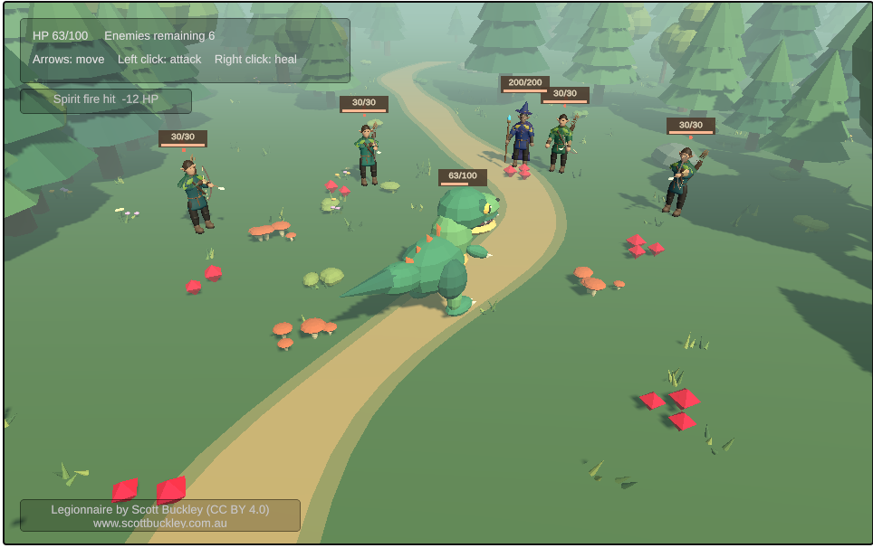

# Firelight Forest｜遊戲介紹與操作

[開啟遊戲｜GitHub Pages](https://hoho0106tw.github.io/FightingFireDragon3/)

## 遊戲介紹

《Firelight Forest》是一款 Unity 3D 戰鬥遊戲。你操控一隻會噴火的恐龍，在林間小徑和空地迎戰森林精靈與魔法師。精靈發現你時會拉弓瞄準，魔法師則會舉起法杖，蓄力發射藍色靈火彈。

你可以從遠處噴火，也可以貼近敵人發動咬擊。擊倒所有敵人後，畫面會顯示「The forest is safe」。恐龍的血量歸零時，遊戲會顯示「GAME OVER」。

## 遊戲場景

*實際遊玩畫面。*

## 電腦操作

| 按鍵 | 操作 |
| --- | --- |
| 方向鍵 ↑ ↓ ← → | 移動恐龍。 |
| 滑鼠左鍵 | 朝游標方向攻擊。遠距離噴火，貼近敵人時交替使用咬擊與噴火。 |
| 滑鼠右鍵 | 回復最多 **20 HP**，冷卻 **5 秒**。 |

## 觸控操作

- **點地面**：恐龍會走向指定位置。
- **點敵人**：恐龍會靠近並攻擊。已在近身距離時，也會使用咬擊。

## 戰鬥與補血

- **近身咬擊**：恐龍會張嘴往前撲，咬中時敵人會慘叫並流血。
- **紅寶石**：地上的紅寶石每群有 **2～3 顆**。恐龍受傷時靠近即可拾取，每顆回復 **5 HP**。
- **血量**：恐龍滿血為 **100 HP**，森林魔法師滿血為 **200 HP**。角色頭頂的血量條可用來判斷戰況。
